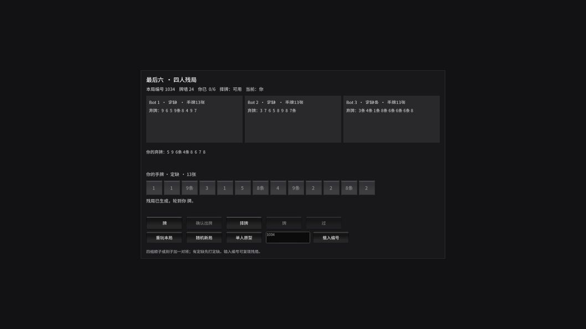

# 川麻最后六摸｜Unity 四人残局 Demo

这是一个以玩法验证为目标的 Unity Demo。玩家与三名 Bot 进入随机生成的四川麻将残局，可以观察四家的公开弃牌，在最多六次摸牌机会内争取先胡牌。每局有一次「择牌」机会：从两张候选牌中选一张，另一张回到牌墙底。

## 下载试玩

点击 [下载 Windows x64 试玩包](LastSixDraws-Windows-x64-v1.0.0.zip)。完整解压后双击 `LastSixDraws.exe`，并保留同目录的 `LastSixDraws_Data` 文件夹及 DLL。无需安装 Unity Editor。

## 玩法操作

1. 观察三家 Bot 与自己的弃牌，判断目标牌的已见数量。
2. 轮到你时点击「摸牌」，或使用一次「择牌」。
3. 摸牌后若可胡，点击「胡牌」；否则选中手牌并点击「确认出牌」。有定缺牌时必须先打定缺花色。
4. Bot 自动行动。若 Bot 的弃牌可以让你胡牌，可选择「胡牌」或「过」。
5. 点击「重玩本局」复现同一开局；点击「随机新局」开始另一局。输入整数编号并点击「载入编号」可复现指定局面。

| 编号 | 可观察的结果 |
| --- | --- |
| `1034` | 玩家有机会接 `8条` 胡牌 |
| `1022` | 玩家有机会在第四摸自摸 |
| `1003` | 不同的首摸选择会导向不同的 Bot 获胜结果 |
| `1001` | 可体验六次摸牌机会用尽 |

随机新局不保证六摸内可胡。Demo 使用万、筒、条共 108 张牌，支持定缺、四组顺子或刻子加一对将、自摸与接炮；暂不包含换三张、碰杠、七对、番型计分、联网或完整血战到底规则。Bot 只根据自己的手牌和定缺做简单弃牌决策。

**验证状态：** Windows x64 包已由 Unity 成功构建，并经使用者实际打开确认可以运行；上表是用于复现玩法的样例，并不代表每个随机局都可解。
